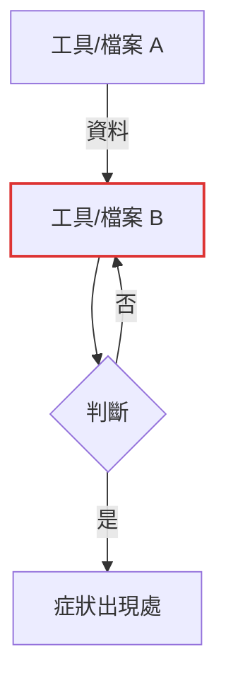

# Stuck Report

You are stuck. Stop changing things. Your job now is to make the human's review fast: what the problem is, what you tried, what you measured and how, and what you need from them.

## 1. Freeze

Make no further fix attempts. Do not start "one last try".

## 2. Save each attempt as a diff

Create the report folder on the real Desktop (resolve it — it may be redirected to OneDrive):

```
pwsh -NoProfile -Command "[Environment]::GetFolderPath('Desktop')"
```

Folder: `<Desktop>\stuck-YYYY-MM-DD-<kebab-topic>\` (ASCII topic, e.g. `stuck-2026-10-28-yazi-preview`).

Write one unified diff per attempt: `attempt-1.diff`, `attempt-2.diff`, … Each must apply cleanly to the original state with `git apply`.

- git repo: `git diff` per attempt (stash or commit-free snapshots between attempts).
- not a git repo: `git diff --no-index <backup> <modified>` against the backup taken before the first edit. If no backup exists, say so in §8 of the report.

Also copy every helper you wrote for the problem — repro scripts, probes, verification harnesses, test pages generators — into `code\attempt-N\` (the attempt it was written for). Scratchpad files vanish; the user must be able to rerun them. Do not copy large third-party files; record their source URL and hash instead.

## 3. Restore the working tree

Revert everything to the state before the first attempt. Exception: a partial fix that is **verified** to help (e.g. it fixed a side issue) may stay — list it in §8.

Verify the restore (`git status` / diff against backup) and record the result.

## 4. Redact

The Desktop may sync to the cloud. Before writing, replace tokens, passwords, keys, cookies, and personal data in diffs and logs with `<REDACTED>`.

## 5. Write `REPORT.md`

Rules:

- Objective facts only. No greeting, no summary paragraph, no "I think it might".
- One line where one line suffices.
- Delete any section that would be empty.
- Every number or finding must be reproducible by the user from §6.
- Write in the user's language.

Flowchart rules (§4):

- Draw the system: the tools, files, and data flow the problem lives in. Not your own procedure — a chain of your steps is a list, not a flowchart.
- Every loop needs its return arrow.
- `flowchart TD`.
- Quote every node and edge label: `x["…"]`, `-->|"…"|`, `-- "…" -->`. Unquoted labels with full-width punctuation (`、`, `§`, `，`) are a lexer error in mermaid 9.

Template:

````markdown
# <one-line problem>

## 1. 目標
預期：…
實際：…

## 2. 環境
OS、相關工具與版本、工作目錄、是否 git repo。

## 3. 限制
動手前就存在的約束：不能動的檔案/鍵位、權限（提權）、沙箱、記憶裡的紅線、使用者先前的決定。

## 4. 流程圖
(Only when the problem involves a toolchain or data flow.)



紅框 = 每次嘗試改動的位置。

## 5. 嘗試紀錄
| # | 假設 | 改動 | 驗證指令 | 結果 |
|---|---|---|---|---|
| 1 | … | attempt-1.diff：… | `…` | 實際輸出摘要 |

### attempt-1.diff
```diff
（diff 原文；超過約 80 行只放關鍵 hunk，並註明完整內容見檔案）
```

### 輔助程式碼（`code/`）
- `attempt-1/<file>`：一行說明用途與用法

## 6. 數據與發現
每項：
- **<數值/現象>**
  - 取得：`<可直接複製的指令>`
  - 手動複現：1. … 2. …
  - 原始輸出：<檔案路徑或貼上關鍵行>

## 7. 已確認 vs 未驗證
- 已排除：<方向> — 依據：<§6 第幾項>
- 未驗證：<猜測>（明確標示為猜測）

## 8. 目前狀態
工作目錄還原結果、保留的部分修正、備份位置。

## 9. 需要你決定/提供的
最多 3 項，具體（要哪個權限、哪份日誌、選 A 或 B）。
````

## 6. Hand off and wait

In chat, post only:

- the folder path,
- §1 and §9 of the report, verbatim.

Then stop. Do not offer further attempts ("want me to try X?"). The user decides the next step.
